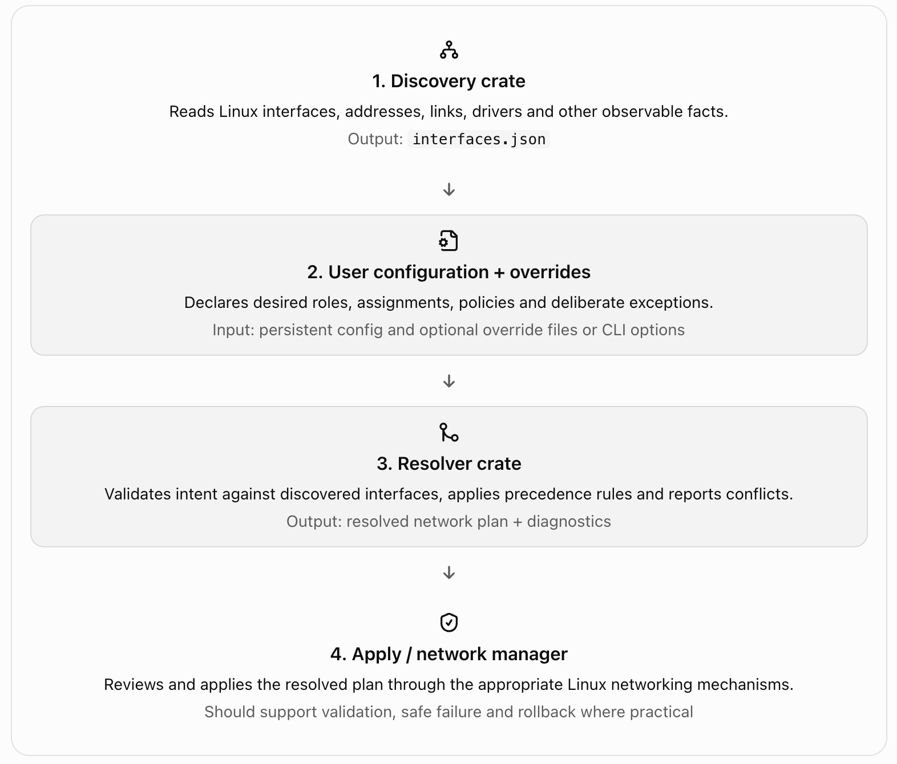

The cleanest architecture is to treat discovery and resolution as two separate stages:

- Discovery observes the machine and writes interface facts to JSON. It should not decide what the network configuration ought to be.
- Resolution combines those observed facts with the user's intended configuration and any explicit overrides, then produces a resolved network plan.
- Application takes that plan and makes changes to the system. It should be a separate stage, so resolving a configuration never unexpectedly changes networking.

The key distinction is that discovery describes reality; the user describes intent; resolution reconciles the two.

## 1. The overall workflow



1\. Discovery crate

Reads Linux interfaces, addresses, links, drivers and other observable facts.

Output: `interfaces.json`

2\. User configuration + overrides

Declares desired roles, assignments, policies and deliberate exceptions.

Input: persistent config and optional override files or CLI options

3\. Resolver crate

Validates intent against discovered interfaces, applies precedence rules and reports conflicts.

Output: resolved network plan + diagnostics

4\. Apply / network manager

Reviews and applies the resolved plan through the appropriate Linux networking mechanisms.

Should support validation, safe failure and rollback where practical

The resolver should be deterministic: given the same facts, configuration and overrides, it should produce the same plan and diagnostics. It should not run `ip` commands to change interfaces, write directly to system networking configuration, or silently guess when configuration is ambiguous.

## 2. Where does the user fit?

For Spider, I would treat the user as the owner of network intent, not as a participant who must manually configure every interface.

For example, discovery might find these interfaces:

```
{
  "interfaces": [
    {
      "name": "enp1s0",
      "mac_address": "02:11:22:33:44:55",
      "admin_state": "UP",
      "operstate": "UP",
      "addresses": []
    },
    {
      "name": "enp2s0",
      "mac_address": "02:11:22:33:44:66",
      "admin_state": "UP",
      "operstate": "DOWN",
      "addresses": []
    }
  ]
}
```

These facts tell Spider that two interfaces exist. They do not tell Spider which interface should be WAN or LAN.

The user supplies that intent, either through an initial setup wizard, a configuration file, or a dashboard:

```
interfaces:
  - match:
      mac_address: "02:11:22:33:44:55"
    role: wan

  - match:
      mac_address: "02:11:22:33:44:66"
    role: lan
    ipv4:
      mode: static
      address: 192.168.10.1/24
```

This example uses a conceptual YAML format; it is not yet a defined Spider schema.

The resolver combines the facts with the intent and determines whether the assignments are valid. It can then produce a plan that says, in effect:

- Assign the first physical interface to the WAN role.
- Assign the second physical interface to the LAN role.
- Configure the LAN interface with the requested static address.
- Report any unresolved decisions or conflicts before anything is applied.

Notice that the user doesn't need to know the internal details of Linux interface discovery. They specify what the interface should do, and Spider maps that intent onto observed hardware.

## 3. How should overrides work?

I recommend distinguishing three different concepts that are often conflated.

A. Persistent user configuration

Normal operation

This is the authoritative, saved configuration: interface roles, addressing modes, VLANs, routing intent and other desired settings. It survives reboot and is the normal input to resolution.

B. Explicit overrides

Temporary or exceptional

These intentionally change how a particular resolution run interprets the saved configuration. Examples include temporarily assigning a different WAN interface, substituting a test configuration, or overriding a detected default. Overrides should be visible, scoped and explainable.

C. Discovered facts

Observed state

These come from the discovery crate: interface names, MAC addresses, carrier state, addresses, device metadata and so on. A user override should not silently rewrite these observations. If the user wants to change the desired behavior, override the intent instead.

That last distinction is particularly important. If discovery says an interface has no carrier, a configuration override can tell Spider to assign that interface as WAN anyway. It should not make the resolver pretend that carrier is present.

## 4. Define a clear precedence order

For the resolver, I would establish this order:

| Priority    | Source                          | Purpose                                                                              |
| ----------- | ------------------------------- | ------------------------------------------------------------------------------------ |
| 1 — highest | Safety and validity constraints | Prevent invalid or unsafe plans regardless of user overrides                         |
| 2           | Explicit runtime overrides      | Deliberate changes for this resolution run                                           |
| 3           | Persistent user configuration   | The saved desired configuration                                                      |
| 4           | Defaults and inference          | Fill in only values that are safe to infer                                           |
| —           | Discovery facts                 | Evidence used to validate and resolve the above, not a competing configuration layer |

The table has one important nuance: discovery facts are not simply the lowest-priority configuration source. They are evidence, not intent. For example, a user can choose which interface is WAN, but cannot configure an interface that does not exist and expect the resolver to silently accept it.

Similarly, safety constraints are not just another overrideable setting. If an override assigns the same physical interface to incompatible WAN and LAN roles, the resolver should reject the result unless Spider explicitly supports that topology.

### Example: changing the WAN interface temporarily

Suppose the saved configuration assigns `enp1s0` to WAN. For a test run, the operator supplies an override assigning `enp2s0` to WAN.

The resolver should:

1. Read the facts for both interfaces.
2. Load the saved configuration.
3. Apply the explicit override to the desired WAN assignment.
4. Validate that the resulting roles and other settings are consistent.
5. Return the resolved plan and a diagnostic explaining that the runtime override replaced the saved WAN assignment.

The saved configuration remains unchanged. If the operator wants the new assignment to persist, they explicitly save it to the normal configuration.

This makes temporary testing predictable and prevents a one-off command from silently changing the router's permanent configuration.

## 5. What should the Rust resolver actually accept and produce?

I would make the resolver a mostly pure library, with file loading and command-line parsing kept at the boundary.

Conceptually:

```
pub struct ResolveInput {
    pub facts: FactsDocument,
    pub config: UserConfig,
    pub overrides: ResolveOverrides,
}

pub struct ResolveOutput {
    pub plan: ResolvedNetworkPlan,
    pub diagnostics: Vec<Diagnostic>,
}

pub fn resolve(input: ResolveInput) -> Result<ResolveOutput, ResolveError>;
```

These are proposed interfaces, not code that assumes your current crate already has those types.

The components have distinct responsibilities:

- `FactsDocument`: the discovery JSON schema you already created.
- `UserConfig`: persistent network intent.
- `ResolveOverrides`: explicit changes for a particular run.
- `ResolvedNetworkPlan`: a fully interpreted, validated plan for the apply stage.
- `Diagnostic`: warnings and explanations, including which source supplied each value.
- `ResolveError`: fatal issues that prevent a valid plan from being produced.

I would also include provenance for important resolved values. For example, the resolved WAN role could record whether it came from a runtime override, the saved configuration or an inferred default. This makes debugging the dashboard and CLI considerably easier.

A useful rule is that the resolver should not silently invent essential choices. If it finds two possible WAN interfaces and the configuration does not identify one, it should return an ambiguity diagnostic rather than arbitrarily selecting the first interface.

## 6. How should this work during local development?

Your discovery crate's `--prefix` option is a separate concern from resolver overrides.

For example:

```
cargo run -- --prefix /tmp/spider-test
```

This redirects the discovery crate's default output into the test tree. The resolver can then be given that facts file and a test configuration.

A clean interface for the resolver could eventually look like:

```
fw-if-resolve \
  --facts /tmp/spider-test/var/lib/spider/facts.d/interfaces.json \
  --config /tmp/spider-test/etc/spider/network.yaml \
  --output /tmp/spider-test/var/lib/spider/resolved/network.json
```

This is a proposed CLI, not a claim that those flags already exist. The important design point is that the resolver's input and output paths should be explicit and independently configurable. That lets you test the whole pipeline without touching the live router's configuration or networking state.

Also, keep test-path selection separate from network configuration overrides. A `--prefix` option changes where files are read or written; it should not change which interface Spider chooses for WAN.

## My recommendation for Spider

Build the resolver around three inputs: discovered facts, persistent user intent, and explicit runtime overrides. Make resolution deterministic and side-effect-free, and emit a plan with diagnostics and provenance. Keep applying that plan in a separate component.

The next design decision I would settle before writing the resolver is how users identify interfaces in persistent configuration. I recommend matching by stable hardware identity where available (typically MAC address, optionally constrained by device information), rather than relying exclusively on Linux names such as `enp1s0`. Interface names can change; the user's intended WAN/LAN assignment should survive that where possible. The resolver can then map the configured identity to the current interface name using the latest discovery facts.

Correct — including `ipv4` in that example does not mean Spider will exclude IPv6 or be IPv4-only. It was just an illustrative configuration fragment, but I should have made the intended dual-stack design explicit.

For Spider, I recommend treating IPv4 and IPv6 as independent, first-class configuration families, with support for both on the same interface by default where appropriate.

For example, the conceptual configuration could look like this:

```
interfaces:
  - match:
      mac_address: "02:11:22:33:44:66"
    role: lan
    ipv4:
      mode: static
      addresses:
        - 192.168.10.1/24
    ipv6:
      mode: static
      addresses:
        - "2001:db8:10::1/64"
```

This example illustrates the schema, not a finalized Spider configuration format. The IPv6 address is from the documentation-only `2001:db8::/32` range.

A few architectural principles follow:

- Independent configuration: IPv4 and IPv6 can each use static addressing, DHCP or other supported mechanisms without requiring the other family to use the same mode.
- Dual-stack support: An interface can have both IPv4 and IPv6 addresses simultaneously.
- Explicit disablement: Disabling one address family should require an explicit policy, rather than its absence from an example being interpreted as a global decision.
- Family-aware resolution: The resolver should validate IPv4 and IPv6 addressing, routes, gateways, and relevant policies separately, while checking cross-family or interface-level conflicts where necessary.
- Discovery remains observational: The discovery crate records the addresses and facts that currently exist; the resolver determines the intended configuration. An IPv6 address found during discovery does not automatically mean IPv6 is configured as desired, and its absence does not mean IPv6 should be disabled.

One further distinction matters for a firewall-router: IPv6 is not simply IPv4 with longer addresses. IPv6 introduces additional considerations, including router advertisements, link-local addresses, neighbor discovery, IPv6 forwarding, and ICMPv6. Those need to be represented in the eventual configuration and application layers rather than hidden inside a generic `ipv4`/`ipv6` address field.

So yes: the intended architecture should be dual-stack-capable from the beginning, with IPv4 and IPv6 independently configurable. The example's `ipv4` section was only illustrative, not a limitation on the design.

Not necessarily. I recommend that `network.yaml` and the resolved `network.json` represent different semantic stages, even if they share many of the same fields.

- `network.yaml` expresses desired configuration — what the user wants Spider to configure.
- `network.json` expresses resolved configuration — what Spider has determined should be applied after combining user intent, discovered interface facts, defaults, and runtime overrides.

The distinction matters because the resolver may fill in values, map stable hardware identities to current Linux interface names, or reject invalid assignments.

### Example

`network.yaml` — user intent

```
interfaces:
  - match:
      mac_address: "02:11:22:33:44:66"
    role: lan
    ipv4:
      mode: static
      addresses:
        - 192.168.10.1/24
```

`network.json` — resolved plan

```
{
  "schema_version": 1,
  "interfaces": [
    {
      "name": "enp2s0",
      "mac_address": "02:11:22:33:44:66",
      "role": "lan",
      "ipv4": {
        "mode": "static",
        "addresses": [
          "192.168.10.1/24"
        ]
      }
    }
  ]
}
```

Here, the resolver has mapped the configured MAC address to the currently discovered Linux interface name, `enp2s0`.

These snippets are illustrative, not a finalized schema.

### What should be semantically identical?

The user's intent should be preserved, but the files need not be semantically identical as documents.

| Property                        | `network.yaml`      | Resolved `network.json`                   |
| ------------------------------- | ------------------- | ----------------------------------------- |
| Primary purpose                 | Declare intent      | Describe the effective plan               |
| Stable hardware matching        | Yes                 | Resolved to discovered interface identity |
| Runtime overrides               | May be absent       | Already incorporated                      |
| Inferred/defaulted values       | May be omitted      | Explicitly resolved where necessary       |
| Validation                      | Input to validation | Must have passed resolution               |
| Suitable for direct application | Not necessarily     | Yes, subject to apply-stage checks        |

One further point: if the resolver applies a temporary runtime override, the resulting `network.json` should represent that effective configuration without modifying `network.yaml`. It should also record provenance or reference the inputs used to produce the result, so operators can understand why a particular value was selected.

My recommendation: treat `network.yaml` as the source of desired state and `network.json` as a generated, validated effective plan. They can share a common underlying model for individual settings, but should have distinct types and clearly defined schemas.

I've created the first implementation of Spider's Rust resolver as a standalone `main.rs` file.

Download resolver_main.rs

## What this implementation does

- Reads the discovery crate's `interfaces.json`.
- Reads the user's `/etc/spider/network.yaml`.
- Matches configured interfaces by MAC address, Linux interface name, or both.
- Gives runtime role overrides precedence over persistent user-configured roles.
- Preserves IPv4 and IPv6 configuration independently.
- Reports unconfigured interfaces and warns if a configured WAN interface has no carrier.
- Generates `network.json` as an atomically written resolved plan.
- Supports `--prefix` for isolated local testing without redirecting explicitly supplied paths.

## 1. Add the dependencies

Add these dependencies to the resolver crate's `Cargo.toml`:

```
[dependencies]
anyhow = "1"
serde = { version = "1", features = ["derive"] }
serde_json = "1"
serde_yaml = "0.9"
tempfile = "3"
```

Save the downloaded file as `src/main.rs`.

## 2. Try it locally

Assuming your test fixture tree contains the discovery output and a configuration file:

```
cargo run -- \
  --prefix /tmp/spider-test
```

The resolver expects these default paths under the prefix:

- `/tmp/spider-test/var/lib/spider/facts.d/interfaces.json`
- `/tmp/spider-test/etc/spider/network.yaml`

It writes the result to:

\- `/tmp/spider-test/var/lib/spider/resolved/network.json`

You can also specify each path independently with `--facts`, `--config` and `--output`.

## 3. Test role precedence

For example, temporarily change the role of `enp2s0` to WAN:

```
cargo run -- \
  --prefix /tmp/spider-test \
  --role-override enp2s0=wan
```

The generated plan records the role source as `runtime_override`. The saved YAML is not modified.

## Important limitation

This is a first-pass resolver, not yet a complete network configuration engine. It handles interface matching, role precedence, basic diagnostics and effective-plan generation. It preserves IPv4 and IPv6 configuration as structured values, but it does not yet validate their detailed semantics, implement automatic role inference, or verify routing, VLAN and firewall consistency.

I'd establish the output schema and validation rules before connecting this to Spider's network-application component. The resolver should never be allowed to turn an ambiguous or invalid configuration into a plan that gets applied silently.
